# Vellum

[](https://github.com/AndreiVladescu/Vellum/actions/workflows/ci.yml)
[](https://github.com/AndreiVladescu/Vellum/releases/latest)
[](LICENSE)


**Vellum is a library manager for the books you have as files and the ones on
your real shelves, shown as a bookshelf you can browse spine-out.** It reads
EPUB and PDF, plays audiobooks, keeps your highlights and reading history, and
remembers which paper copy sits in which bookcase and who borrowed it. It all
runs on your own computer or phone, with no account and nothing uploaded. If
you want the same library on several devices, or want to share it with your
household, there is an optional server you host yourself. Free and open source
(AGPL-3.0), for Linux, Windows, macOS and Android, in English and Romanian.

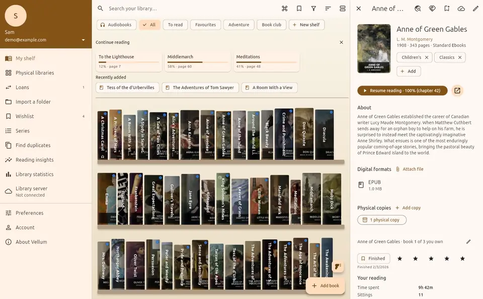

<sub>The same clip as a video: [vellum-promo.mp4](img/vellum-promo.mp4). Every
book you see is in the public domain. See [the credits](#credits).</sub>

> **This project was written by an LLM.** The code, the tests and this README
> were generated by Claude working from prompts, with a human directing and
> reviewing the result. It is a real, working program — but it has not been
> through the kind of adversarial testing a project you trust with your only
> copy of something should have. Keep your book files backed up elsewhere, and
> read [Is it safe to use?](#is-it-safe-to-use) before pointing it at a library
> you care about.

---

## Download

Everything is on the **[latest release](https://github.com/AndreiVladescu/Vellum/releases/latest)**.

| System | File | How |
|---|---|---|
| Linux, any distribution | `Vellum-<version>-x86_64.AppImage` | `chmod +x` it and run it. Nothing to install. |
| Debian, Ubuntu, Mint | `vellum_<version>_amd64.deb` | `sudo apt install ./vellum_*.deb` |
| Linux, anything else | [`vellum-linux-x64.tar.gz`](https://github.com/AndreiVladescu/Vellum/releases/latest/download/vellum-linux-x64.tar.gz) | Extract it, then run `./install.sh` |
| Windows | [`vellum-windows-x64.zip`](https://github.com/AndreiVladescu/Vellum/releases/latest/download/vellum-windows-x64.zip) | Unzip it and run `vellum.exe` |
| macOS | [`vellum-macos.zip`](https://github.com/AndreiVladescu/Vellum/releases/latest/download/vellum-macos.zip) | Unzip it and open `vellum.app` |
| Android 7 and later | [`app-arm64-v8a-release.apk`](https://github.com/AndreiVladescu/Vellum/releases/latest/download/app-arm64-v8a-release.apk) | Install it. This is the right file for almost every phone in use; a very old one needs the `armeabi-v7a` file instead. |
| The server | Docker, or a binary for Linux, macOS or Windows | See [below](#the-server-with-docker) |

The `.deb` and `install.sh` both put a `vellum` command on your PATH and add a
menu entry. Undo either with `sudo apt remove vellum` or
`./install.sh --uninstall`. Your library is left alone either way. Audiobooks
on Linux need `libmpv`. The `.deb` installs it; with the AppImage or the
tarball, install `libmpv2` yourself. Everything else works without it.

The Windows and macOS builds are not signed. On Windows, SmartScreen wants
*More info → Run anyway*. On macOS, right-click the app and choose *Open* the
first time. Vellum is not on Google Play or F-Droid yet, so on Android you
allow installs from your browser or file manager.

Each release lists SHA-256 checksums (`SHA256SUMS-*`) for its files.

### The server with Docker

You don't need the server to use Vellum. If you want one:

```sh
docker run -d --name vellum -p 3000:3000 \
  -v vellum-data:/var/lib/vellum \
  ghcr.io/andreivladescu/vellum-server
```

Open <http://localhost:3000> and create the master account. In the app, go to
☰ → *Library server*. The image is built for `amd64` and `arm64`, so it runs
on a Raspberry Pi 4 or 5. A phone needs HTTPS to connect.
**[docs/DEPLOYMENT.md](docs/DEPLOYMENT.md)** covers that, along with Docker
Compose with automatic certificates, backups and running behind a reverse
proxy.

---

## What it does

**The shelf**
- Your books spine-out, with spines drawn from their covers, or face-out, or as
  a plain list. Group them by author, series or genre.
- Your own shelves, filters by genre, reading status and audiobooks, a
  wishlist, a series page that shows which volumes you are missing, and a
  duplicate finder.
- On a wide window, a book opens in a pane beside the shelf. `Ctrl+K` opens a
  command palette that finds any book or action.
- Light and dark themes, spine styles and shelf wallpapers.

**Reading**
- Built-in EPUB and PDF readers that remember your place. EPUBs read in pages
  or as one long scroll, with your choice of typeface, size, spacing and line
  width.
- Highlights in four colours, notes and bookmarks, search inside the book, and
  night mode.
- Read aloud with your device's voices. Translate a passage on the device: no
  text leaves it.
- Reading insights: time read, pages, streaks, goals, a heat map, a month by
  month view and a year in review you can save as a picture.

**Audiobooks**
- Import an `.m4b`, or a folder of `.mp3` files. Chapters, narrator and cover
  come with it.
- Speed from 0.5× to 3× with the pitch kept, a sleep timer and 30-second skips.
  Playback continues in the background, with controls on the lock screen and
  in your desktop's media controls.
- Listening has its own insights and never counts as pages read.

**Physical books and loans**
- Draw your room and its bookcases, then place each paper copy where it really
  stands. A photo of your actual shelves can sit behind them.
- Lend a book and record who has it and when it is due back. Overdue loans
  show up, and the lending history is kept after a book comes back.
- Scan an ISBN barcode to add a book. Take photos of a copy's condition. Do a
  stocktake of a room, and print shelf labels.

**Getting your library in**
- Search Open Library and Google Books, and the cover, author and description
  fill themselves in.
- Import a folder of files, a Calibre library, a Goodreads or StoryGraph export
  (with your ratings, shelves and reviews), or an OPDS catalogue. Every import
  shows you what it found before it writes anything.

**The optional server**
- A small Rust server that you host yourself. It keeps a desktop and a phone in
  sync, and works with a Raspberry Pi.
- Accounts with roles, shared libraries and public links to single books. In a
  shared library your highlights, notes, ratings and reading position stay
  yours.
- An OPDS feed for e-readers, KOReader progress sync in both directions,
  two-factor sign-in and app passwords.

**Private and local-first**
- Works fully offline. There is no account and no telemetry.
- The only lookups are Open Library and Google Books, when you search for a
  book to add. Nothing else leaves your device unless you set up a server.
- Your library is one folder on your disk. Backups, optionally encrypted, can
  run on a schedule. A deleted book sits in the trash for 30 days.

---

## Screenshots

| | |
|---|---|
| 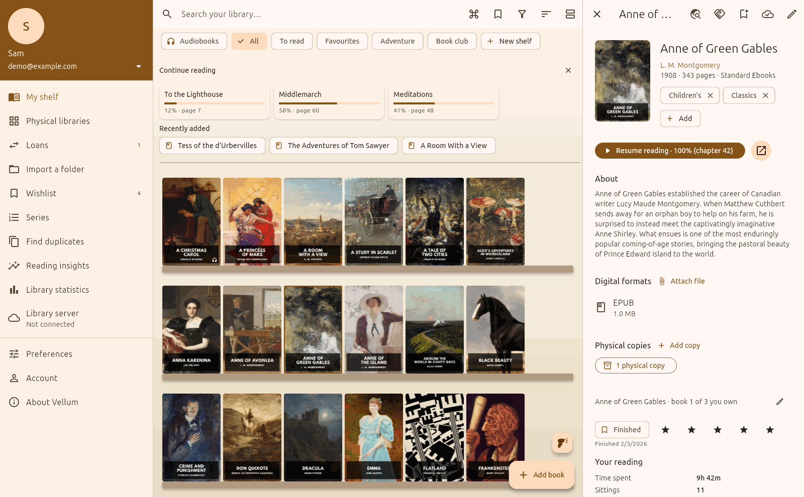 **Face-out.** The same shelf with the covers showing. | 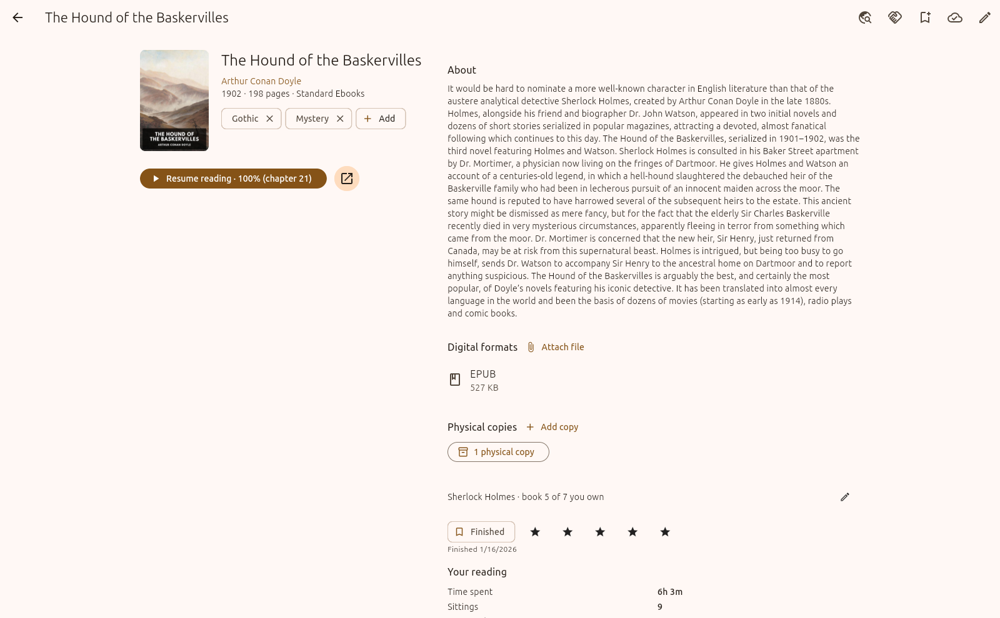 **A book's page.** Its files, paper copies, series, rating and your reading history. |
| 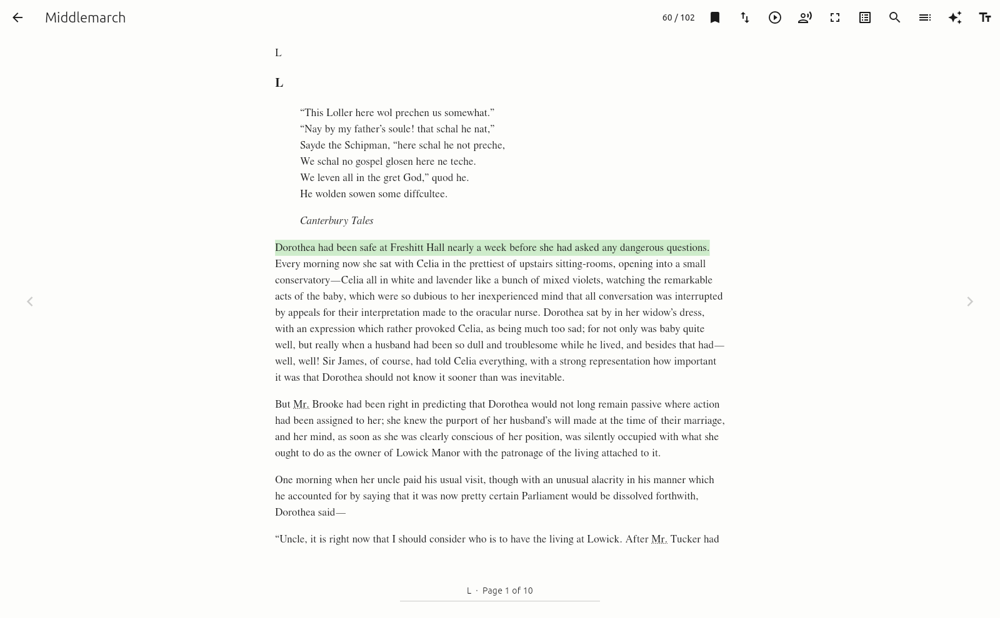 **Reading.** A paged EPUB with a highlight from today. | 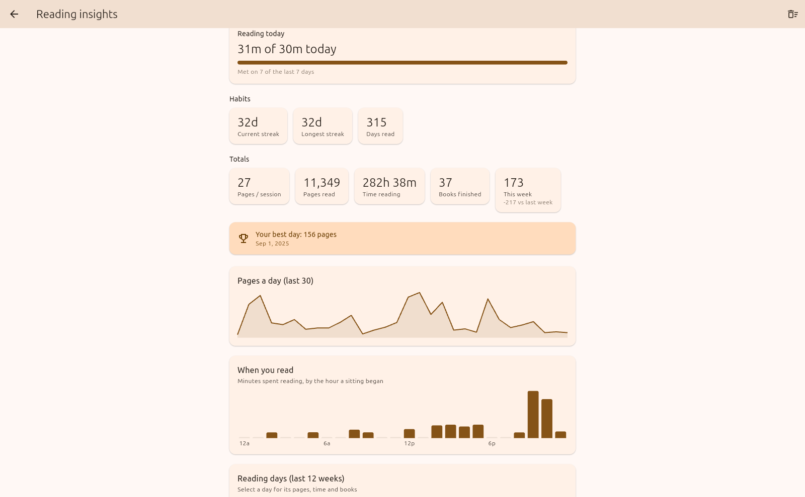 **Insights.** Streaks, totals and when you read. |
| 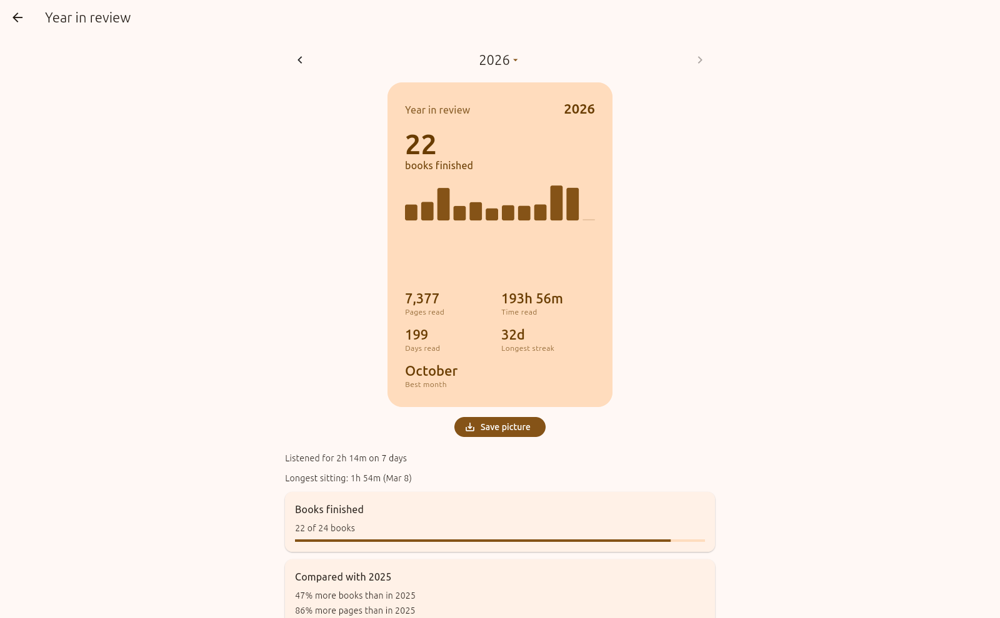 **Year in review.** A picture you can save or share. | 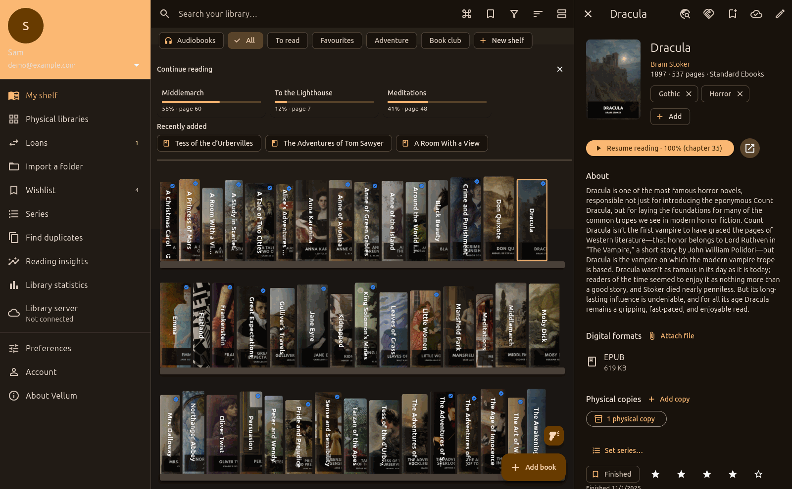 **Dark theme.** |
| 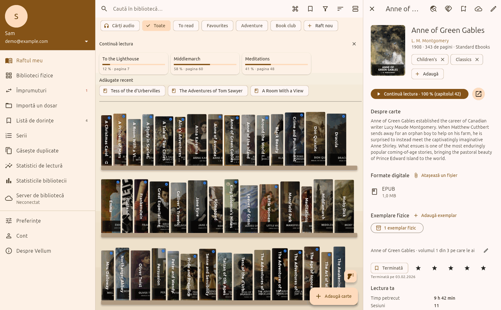 **În română.** The interface follows your system language, or you can choose one. | 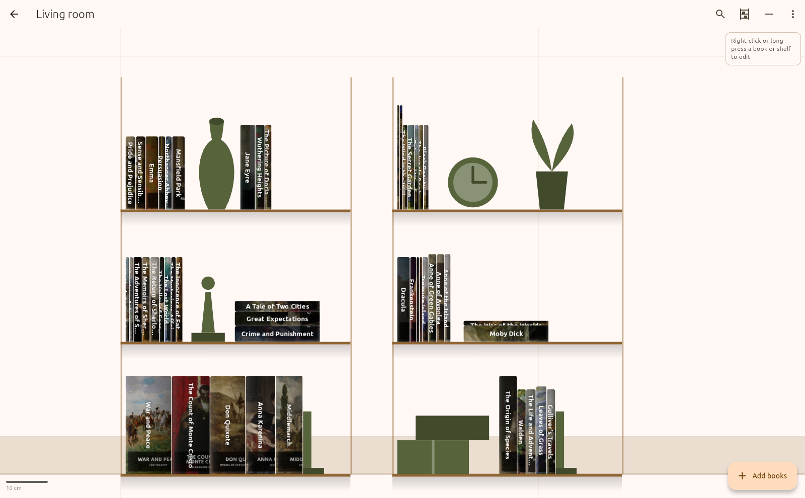 **Your room.** Where each paper copy stands. |

On a phone:

<p>
  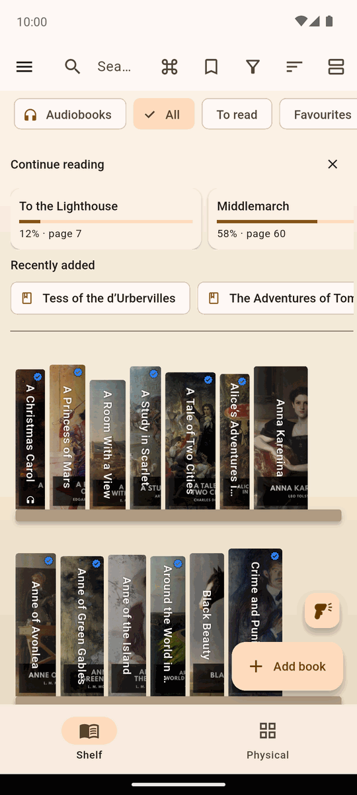
  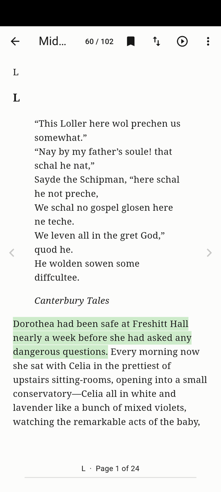
  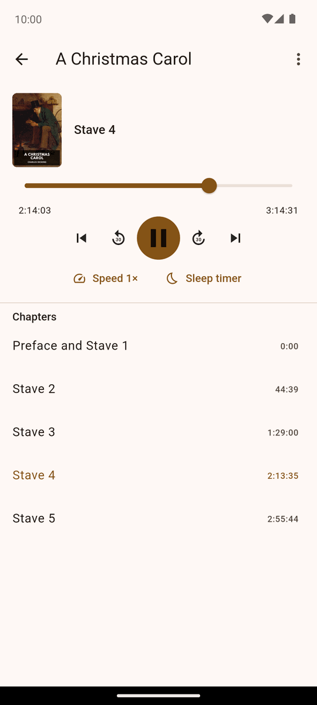
  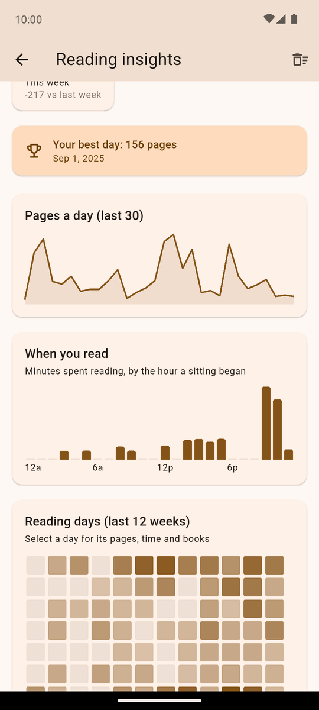
  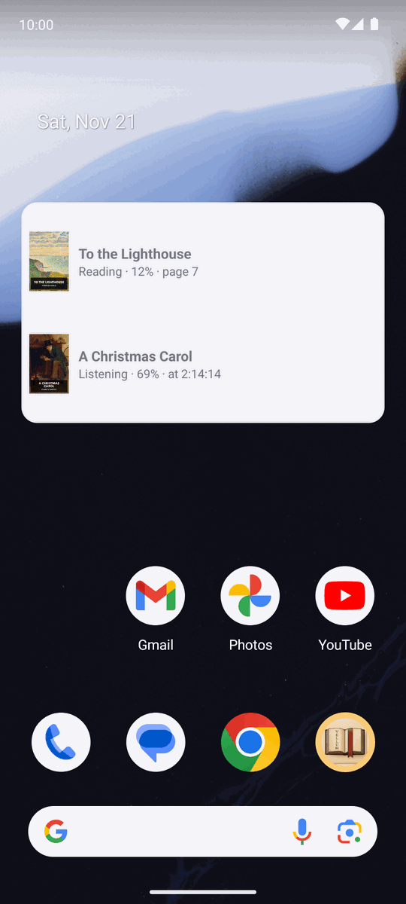
</p>

### Credits

The library in these pictures and in the clip is made entirely of public-domain
books. The ebooks and their cover art come from
**[Standard Ebooks](https://standardebooks.org)**, who dedicate their work to
the public domain (CC0). The audiobook is the
**[LibriVox](https://librivox.org/a-christmas-carol-by-charles-dickens/)**
volunteers' public-domain recording of *A Christmas Carol*. Thank you to both.
The reader's name, shelves, loans and reading history are made up.
`app/tool/demo_library.sh` builds the same library from those sources, and
`app/tool/demo_library/manifest.json` lists every file and its licence.

---

## Contents

- [Building it yourself](#building-it-yourself)
- [Your first ten minutes](#your-first-ten-minutes)
- [Bringing in a library you already have](#bringing-in-a-library-you-already-have)
- [Reading](#reading)
- [Audiobooks](#audiobooks)
- [Physical books and loans](#physical-books-and-loans)
- [Where your data lives, and backing it up](#where-your-data-lives-and-backing-it-up)
- [Keyboard shortcuts](#keyboard-shortcuts)
- [Optional: sharing a library between devices](#optional-sharing-a-library-between-devices)
- [When something goes wrong](#when-something-goes-wrong)
- [Is it safe to use?](#is-it-safe-to-use)
- [For developers](#for-developers)

---

## Building it yourself

You don't need to build it: the [downloads](#download) above are ready to run.
To build it from source anyway takes about ten minutes, most of which is the
toolchain downloading. What follows is the short version.
[DEVELOPER.md](DEVELOPER.md) has the detailed guide for each platform,
including Windows and Android.

### 1. Install Flutter

Follow the official installer for your system:
**<https://docs.flutter.dev/get-started/install>**

Vellum needs **Flutter 3.50 or newer** (Dart SDK 3.14). Check what you have:

```sh
flutter --version
```

### 2. Install the desktop build tools

Flutter builds a real native app, so it needs your platform's C++ toolchain.

**Linux (Debian/Ubuntu):**

```sh
sudo apt install clang cmake ninja-build pkg-config libgtk-3-dev liblzma-dev \
                 libsecret-1-dev
```

`libsecret-1-dev` is where the server token is stored; leaving it out fails the
build at the CMake step rather than at runtime.

**macOS:** install Xcode from the App Store, then:

```sh
sudo xcodebuild -runFirstLaunch
```

**Windows:** install **Visual Studio 2022** (not VS Code) with the
*"Desktop development with C++"* workload ticked.

Then confirm everything is in place — this is the single most useful command
when anything is wrong:

```sh
flutter doctor
```

You only need the section for your own platform to be green. Android, web and
iOS warnings don't matter unless you want to build for those.

### 3. Get Vellum and run it

```sh
git clone https://github.com/AndreiVladescu/Vellum.git
cd Vellum/app
flutter run -d linux      # or: -d macos   /   -d windows
```

The first run compiles from scratch and takes a few minutes. After that it
starts in seconds.

### 4. Build a copy you can keep

`flutter run` is the development mode. For a proper build you can launch like
any other program:

```sh
flutter build linux --release      # or: macos / windows
```

The result lands in:

| Platform | Path |
|---|---|
| Linux | `app/build/linux/x64/release/bundle/vellum` |
| macOS | `app/build/macos/Build/Products/Release/vellum.app` |
| Windows | `app\build\windows\x64\runner\Release\vellum.exe` |

On Linux, keep the whole `bundle` folder together — the executable needs the
`lib` and `data` folders beside it. Move the folder wherever you like and make a
shortcut to the binary inside it.

### Android

Vellum builds for Android too. That needs JDK 17, the Android SDK and a signing
key — see [DEVELOPER.md](DEVELOPER.md#app-android).

---

## Your first ten minutes

The first time it opens, a short walkthrough offers to get your books in, point
you at a server (optional), and set up a room for your physical shelves. You can
skip it — everything it offers is reachable later from the ☰ menu.

Then you'll be looking at an empty shelf with an **Add book** button.

**Add a book you own the file for.** Press *Add book*, search by title or
author, pick the right result, and attach your PDF or EPUB. Vellum fills in the
cover, author, publisher and description from Open Library and Google Books, so
you usually only type a few words.

**Don't have the file?** Add it anyway. A book with no file is a record of a
physical copy — where it is on your shelves, and who you lent it to.

**Scan a barcode.** The small barcode button above *Add book* looks up an ISBN.
With a camera it scans the back of the book; on a desktop without one, you type
the number.

**Fix anything it got wrong.** Open a book and edit any field. If you make a
mess, *Revert to library defaults* puts back what was originally imported.


A book's own page is where its files, its paper copies, its series, your rating
and your private notes all live. *Read* picks up where you stopped; a book with
no file has it greyed out.

**Keep a wishlist.** Books you want but don't own live in ☰ → *Wishlist*, off
the shelf until you attach a file or record a copy — which moves them into the
library by itself. Handy for filling gaps in a series, or scanning something in
a bookshop.

**See what you've been reading.** ☰ → *Reading insights* keeps your sittings,
pages turned and finished books.

**Make it look how you want.** ☰ → *Preferences* controls the shelf: spine
colours and lettering, the wallpaper behind the shelves, whether books show
spine-out or cover-out, and light/dark for the app itself.

---

## Bringing in a library you already have

☰ → *Import a folder* handles four sources:

| You have | Choose | Brings the files |
|---|---|---|
| A folder of PDFs and EPUBs | **A folder of files** | Yes |
| A Calibre library | **A Calibre library** | Yes, with covers |
| A spreadsheet, or a Goodreads export | **A CSV or JSON catalogue** | No — records only |
| Another server's catalogue | **An OPDS catalogue** | Yes, what you pick |

Whichever you choose, Vellum shows you **everything it found and what it thinks
you already have, before writing anything**. Nothing is added until you confirm,
and you can untick individual books.

Naming your files `Author - Title (Year).epub` gets you much better results from
a folder import, but it isn't required.

For the exact CSV columns — and the aliases that let a Goodreads or StoryGraph
export import without editing — see **[docs/IMPORTING.md](docs/IMPORTING.md)**.
The import screen also has a **How?** button that shows the same thing and can
save you a filled-in template spreadsheet.

---

## Reading

Press **Read** on any book with a PDF or EPUB. The button remembers where you
stopped, so it becomes *Resume reading · 43%* next time.

- **Turning pages** — click or tap the left or right edge of the page, swipe,
  or use the arrow keys, Page Up/Down or Space. An EPUB reads in pages or as
  one continuous scroll; switch in its reading options.
- **Highlighting** — select text, then press the highlighter. Four marker
  colours; the swatch beside the button changes which one you're holding.
- **Notes and bookmarks** — same place as highlights; everything you mark is
  listed on the book's page afterwards.
- **Finding a passage** — `Ctrl+F` searches inside the book, in both formats.
- **Jumping to a page** — `Ctrl+G`, or click the page counter in the toolbar.
- **Night mode** — black pages, white type, pictures in grey. It lives with the
  other reading options: the *Tt* button in an EPUB, the ⋮ menu in a PDF. Those
  also hold page colour, and — for EPUBs — typeface, text size, line spacing and
  line width.
- **Read aloud** — both readers can read the book to you, a sentence at a time,
  turning pages as they go, with your device's own voices (`speech-dispatcher`
  on Linux). `Ctrl+Shift+R` starts and stops it.
- **Prefer a different reader?** The **open-in-new** button next to *Read* hands
  the file to whatever your system uses for PDFs and EPUBs.

PDFs have two ways to move, toggled from the toolbar: **Pages**, where you see
one page at a time and an edge click turns it, and **Scrolling**, which is
continuous with a scrollbar down the right-hand side.

---

## Audiobooks

Import an `.m4b`, or a folder of `.mp3` files (`CD1`/`CD2` folders join up),
and it becomes a book with its chapters, narrator and cover. Press *Listen* on
the book's page. A book can hold an EPUB and its audiobook at once, each with
its own place.

The player has 30-second skips, chapters, a speed from 0.5× to 3× (kept per
book, pitch kept) and a sleep timer that fades out, including *end of
chapter*. Playback carries on in the background, with controls in the
notification, on the lock screen, on Bluetooth buttons and in your desktop's
media controls. Insights has a *Listening* switch with its own time, streaks
and heat map. On Linux the player needs `libmpv`; see [Download](#download).

---

## Physical books and loans

The second tab is for books as objects. Create a **library** (a room), add
**shelves** to it, and record which copy sits where — including a photo of the
shelf as a backdrop, so you can place books on the picture of your actual room.


Books stand, stack or lie flat, and a shelf takes ornaments as well — the point
is that it ends up looking like the shelf you actually own.

When you lend a book, record who has it and when it is due back. ☰ → *Loans*
counts the overdue ones. Loans are kept as history, so returning a book
doesn't erase the fact it was lent — you keep the record of who has borrowed
what over the years.

---

## Where your data lives, and backing it up

Your library is on your own disk, all of it in one directory:

| Linux | macOS | Windows |
|---|---|---|
| `~/.local/share/app.vellum.Vellum/` | `~/Library/Application Support/app.vellum.Vellum/` | `%APPDATA%\app.vellum\Vellum\` |

The catalogue (`vellum.sqlite`), your book files, covers and settings all live
there together, so copying that one folder copies your whole library.

*Before v1.1.1 the database sat in your Documents folder instead. It is moved
there automatically the first time a newer version starts.*

**Back it up from inside the app**: ☰ → *Preferences* → *Backup* writes the
database, covers and book files into a single archive, optionally encrypted with
a passphrase. Restore puts it all back, on this machine or another one. You can
also have it run automatically on a schedule.

Deleting a book puts it in a **trash** that holds it for 30 days, so a mis-click
isn't a restore-from-backup.

---

## Keyboard shortcuts

Press `Ctrl+K` (`⌘K` on macOS) for the command palette — it lists every action
and its shortcut, and jumps to any book by name. The ones worth learning:

| | |
|---|---|
| `Ctrl+K` | Command palette |
| `Ctrl+F` | Search your library — and, in a book, search inside it |
| `Ctrl+N` | Add a book |
| `Ctrl+I` | Import a folder |
| `Ctrl+B` | Switch between spines and covers |
| `Ctrl+G` | *(in a book)* Go to page |
| `F5` | Sync with the server |
| `Ctrl+,` | Preferences |
| `Esc` | Clear the search and filters — or close the find bar |
| `Alt+←` / `Alt+→` | Back and forward, as do the mouse's side buttons |

---

## Optional: sharing a library between devices

**You do not need this.** The app is complete on its own, works offline, and
never contacts a server unless you tell it to. Set one up only if you want:

- the same library on a desktop and a phone, kept in sync,
- other people with their own accounts and permissions,
- an OPDS feed so an e-reader can pull books directly,
- public links to share one book with someone,
- KOReader progress sync.

Quick try on your own machine:

```sh
cd server
cargo run          # needs Rust: https://rustup.rs
```

That starts the API on <http://localhost:3000> and creates its database beside
itself. Open that address in a browser for the admin console — on a server with
no accounts it opens on *Create the master account*, and the account you make
there owns the library. In the app, ☰ → *Library server*, enter the address, and
log in.

Everything else is configured by environment variables, and
**[`server/.env.example`](server/.env.example)** lists all of them with their
defaults — the port and database path, TLS for a LAN server, SMTP so password
resets can be emailed, and the bootstrap token that stops a stranger claiming
the master account on a server you've exposed. Copy it and edit:

```sh
cd server
cp .env.example .env         # .env is gitignored; chmod 600 it, it holds a password
set -a; . ./.env; set +a
cargo run
```

Over a network — especially to a phone — you need HTTPS, and there are real
decisions to make about certificates, backups and running it as a service.
That is all in **[docs/DEPLOYMENT.md](docs/DEPLOYMENT.md)**, including Docker
and Docker Compose with automatic TLS. With Docker, no clone or build is needed:

```sh
docker run -d -p 3000:3000 -v vellum-data:/var/lib/vellum ghcr.io/andreivladescu/vellum-server
```

---

## When something goes wrong

**`flutter: command not found`** — Flutter isn't on your `PATH`. Reopen your
terminal after installing, or add its `bin` folder yourself.

**`flutter doctor` complains about Android or Chrome** — ignore it. You only
need your own desktop platform to be green.

**The build fails on Linux mentioning GTK, ninja or clang** — the build tools
from step 2 are missing. Run the `apt install` line and try again.

**The build fails after you pulled a newer version** — clear the build cache:

```sh
cd app
flutter clean
flutter pub get
flutter run -d linux
```

**A PDF won't open, or a book shows no cover** — the file it points at has
probably moved or been deleted. ☰ → *Preferences* → *Library health* finds
exactly this: books whose file is gone, covers that vanished, and files on disk
no book refers to any more. It tells you what it found and lets you decide
whether to repair each kind.

**Reporting a bug** — ☰ → *Preferences* → *Library health* → *Copy diagnostics*
(or *Show* to read it first) and paste the result into your bug report. It holds
versions, counts and recent errors, never your book titles or server address.

**The app opens to an empty shelf after moving machines** — the library is the
data folder from [the table above](#where-your-data-lives-and-backing-it-up).
Copy that whole folder across, or better, restore a backup archive.

**A search finds nothing you expect** — the shelf search matches titles and
authors. To search *inside* books on a desktop, switch on ☰ → *Preferences* →
*Search inside books*. With a server, the server has to index the text
(`VELLUM_INDEX_TEXT=1`).

---

## Is it safe to use?

Being honest about what this is:

- **The code was written by an LLM.** It is tested — over two thousand
  automated tests run against the app and the server, and the readers and
  importers have been driven by hand — but that is not the same as years of use
  by many people.
- **It never deletes your original files.** Importing copies files into its own
  folder; the originals stay where they were. Removing a book moves it to a
  trash that holds it for 30 days.
- **It works offline and keeps everything local.** Metadata lookups go to Open
  Library and Google Books when you add a book, and nothing else leaves your
  machine unless you set up the server.
- **Back up anyway.** Use the built-in backup, and keep your book files
  somewhere Vellum isn't the only copy.

---

## For developers

**Start with [DEVELOPER.md](DEVELOPER.md)** — the full build guide: what to
install on Linux, Windows and macOS, how to build the app and the server on each,
Android and Docker, the test loop, schema changes, and how a release is cut.

| Directory | What | Stack |
|---|---|---|
| [`app/`](app/) | Desktop (Linux/Windows/macOS) + Android app | Flutter, SQLite (drift) |
| [`server/`](server/) | Optional self-hosted library server | Rust, axum, SQLite (sqlx) |

```sh
cd app
flutter test          # ~1,900 tests
flutter analyze       # lint and static analysis
dart run build_runner build --delete-conflicting-outputs   # after schema changes

cd ../server
cargo test
cargo clippy
```

The architecture, data model and build order are in
[DESIGN.md](DESIGN.md). Other documents:

| | |
|---|---|
| [DEVELOPER.md](DEVELOPER.md) | Building, testing and releasing, on every platform |
| [docs/IMPORTING.md](docs/IMPORTING.md) | Catalogue file formats and filename rules |
| [docs/DEPLOYMENT.md](docs/DEPLOYMENT.md) | Running the server properly |
| [docs/FDROID.md](docs/FDROID.md) | Publishing to F-Droid, and what blocks it |
| [docs/ACCESSIBILITY.md](docs/ACCESSIBILITY.md) | Screen readers, contrast, text scaling |
| [docs/PERFORMANCE.md](docs/PERFORMANCE.md) | Where the time goes, and the budgets |
| [docs/SECURITY_AUDIT.md](docs/SECURITY_AUDIT.md) | What has been reviewed, and what hasn't |

Building for Windows, Android, or anything beyond the quick commands above is in
**[DEVELOPER.md](DEVELOPER.md)**.

---

## Status

The current release is v1.6.0. What changed in each release is in
[CHANGELOG.md](CHANGELOG.md), and what comes next is in
[docs/ROADMAP.md](docs/ROADMAP.md).

Sync between the app and the server goes **both ways**, with last-write-wins by
timestamp and delete tombstones, so edits and deletions propagate instead of
resurrecting. The design is in [DESIGN.md](DESIGN.md).

---

## Licence

Vellum is free software under the **GNU Affero General Public License v3.0** —
see [LICENSE](LICENSE).

In plain terms: use it for anything, change it, share it. The one condition is
that anything you pass on stays under the same licence, source included. The
"Affero" part extends that to running it as a service: if you host a modified
Vellum server for other people, those people are entitled to your changes, even
though you never handed them a copy of the program.

That is the trade this project is making deliberately — take it and build on it,
but improvements come back rather than disappearing into a closed fork.
